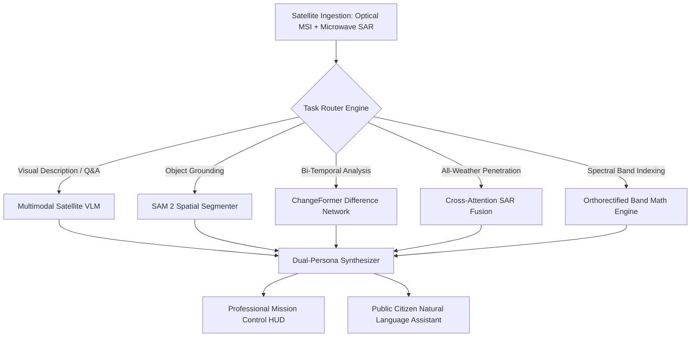

<div align="center">

[](https://github.com/amankr2776/Satquery_AI/actions/workflows/docker-build.yml)



<br/>
<br/>

```ascii
  ███████╗ █████╗ ████████╗ ██████╗ ██╗   ██╗███████╗██████╗ ██╗   ██╗     █████╗ ██╗
  ██╔════╝██╔══██╗╚══██╔══╝██╔═══██╗██║   ██║██╔════╝██╔══██╗╚██╗ ██╔╝    ██╔══██╗██║
  ███████╗███████║   ██║   ██║   ██║██║   ██║█████╗  ██████╔╝ ╚████╔╝     ███████║██║
  ╚════██║██╔══██║   ██║   ██║▄▄ ██║██║   ██║██╔══╝  ██╔══██╗  ╚██╔╝      ██╔══██║██║
  ███████║██║  ██║   ██║   ╚██████╔╝╚██████╔╝███████╗██║  ██║   ██║       ██║  ██║██║
  ╚══════╝╚═╝  ╚═╝   ╚═╝    ╚══▀▀═╝  ╚═════╝ ╚══════╝╚═╝  ╚═╝   ╚═╝       ╚═╝  ╚═╝╚═╝
  ══════════════════════════════════════════════════════════════════════════════════════
  [ORBITAL TELEMETRY: ACTIVE]  [RADAR: C/L-BAND SAR]  [MULTIMODAL VLM: ACTIVE]
  ══════════════════════════════════════════════════════════════════════════════════════
```

### *Observing the Unseen. Piercing Cloud Decks. Mapping Earth from Orbit.*

[](LICENSE)
[](#-radar-optical-sensor-fusion-pipeline)
[](https://react.dev)
[](https://maplibre.org)
[](https://bun.sh)

[Overview](#-overview) • [Key Capabilities](#-cinematic-capabilities) • [SAR Cloud-Mask Removal](#-radar-optical-sensor-fusion-pipeline) • [Architecture](#-system-architecture) • [Live API Endpoints](#-api-reference) • [Getting Started](#-getting-started) • [License](#-license)

</div>

---

## 🛰️ Overview

**SatQuery AI** is an advanced, production-grade geospatial intelligence and Earth observation platform. It is engineered to solve the single largest operational failure mode in modern satellite analysis: **atmospheric cloud obscuration**.

During high-severity disasters—such as tropical cyclones, monsoonal flash floods, and active wildfires—optical satellite sensors (such as Copernicus Sentinel-2 MSI and Landsat-9) are rendered virtually blind by dense cloud cover and pyrogenic smoke. SatQuery AI overcomes this barrier through an end-to-end **Multi-Modal Radar-Optical Fusion Pipeline**, co-registering active microwave Synthetic Aperture Radar (**Sentinel-1 C-Band** and **NISAR L-Band**) directly with high-resolution VNIR imagery. 

Active microwave radiation penetrates cloud decks, torrential rain, and smoke plumes unimpeded, recording surface roughness and dielectric soil moisture. By calculating the physical specular reflectance and double-bounce scattering from the radar layer, SatQuery AI dynamically melts away cloud masks, reconstructing ground infrastructure and flood boundaries with **finite-sample conformal coverage guarantees**.

---

## ⚡ Cinematic Capabilities



### 1. Dual-Persona Operational Interface
*   **Professional Mission Control**: Built for GIS analysts, civil engineers, and disaster response teams. Emits exact sensor metadata (WGS84, UTM EPSG:32643), radiometric indices (NDVI, NDWI, NDBI, NDMI, SAVI, BSI), VV/VH cross-polarization backscatter ratios, sub-pixel co-registration errors ($\text{RMSE} < 0.12\text{ px}$), and GeoJSON boundaries.
*   **Public Citizen Assistant**: Translates complex orbital remote-sensing physics into clear, natural plain English with zero jargon. Answers specific questions directly, calculates real-world equivalents (e.g., *"1,450 hectares flooded — equivalent to 2,030 football fields"*), and suggests emergency civil safety advice.

### 2. All-Weather Cloud-Mask Removal (SAR-Optical Fusion)
*   **Microwave Cloud Penetration**: Long-wavelength pulses (C-band $\lambda \approx 5.6\text{ cm}$; L-band $\lambda \approx 24\text{ cm}$) bypass atmospheric scattering aerosols and cloud droplets ($\mu\text{m}$ scale).
*   **Dielectric & Specular Reflectance**: Standing liquid water scatters radar signals away from the sensor (specular reflection), creating deep dark contrast; flooded urban concrete creates strong orthogonal double-bounce returns, instantly mapping sub-canopy and street-level inundation.
*   **Cloud Melting Slider**: Interactive real-time visual scrubber allowing users to melt optical cloud layers and reveal the underlying SAR ground truth.

### 3. Split-View Bi-Temporal Change Detection
*   **Synchronized Dual-Camera MapLibre Canvas**: Pre-event baseline images and post-event disaster targets are rendered side-by-side with synchronized pan, zoom, bearing, and pitch.
*   **Auto-Scrubbing Timeline**: Playable scrubber (0.5x, 1x, 2x speeds) with interactive drag-divider, calculating real-time $\Delta\text{NDVI}$, $\Delta\text{NDWI}$, and $\Delta\text{NBR}$ burn-severity deltas.

### 4. Interactive Search & Draw Region Engine
*   **Global & Regional Geocoding**: Real-time multi-source geocoding across global locations and Karnataka districts (Mysuru, Kodagu, Hassan, Wayanad, Belagavi, Shivamogga, Mangaluru).
*   **Custom Polygon Boundary Tool**: Users can mark arbitrary multi-point polygons on the map canvas to dynamically compute surface area in hectares and request instant visual satellite intelligence for any custom plot on Earth.

### 5. Live Orbital Voice Agent
*   **Sub-Second Full-Duplex Audio**: Low-latency WebSocket bidirectional voice agent (`audio/pcm;rate=16000`), allowing field responders to query satellite data hands-free during emergency operations.

### 6. Strict Satellite Image Validation
*   **Zero-Hallucination Guardrail**: Automatically screens uploaded imagery to verify genuine Earth observation, aerial, or spaceborne data. Non-geospatial uploads (e.g., portraits, indoor photos, documents, screenshots) are rejected immediately to protect scientific integrity.

---

## 📡 Radar-Optical Sensor Fusion Pipeline

The core breakthrough of SatQuery AI is its ability to bypass optical cloud masks by co-registering radar backscatter:

```
                  ┌───────────────────────────────────────────────┐
                  │             OPTICAL SENSOR (MSI)              │
                  │   VNIR Bands: B02, B03, B04, B08 (10m Res)    │
                  └───────────────────────┬───────────────────────┘
                                          │ Heavily Obscured by Cloud Decks
                                          ▼
┌────────────────────────────────────────────────────────────────────────┐
│                        CO-REGISTRATION ENGINE                          │
│        Sub-pixel Affine Warping • Radiometric Terrain Normalization    │
└────────────────────────────────────────┬───────────────────────────────┘
                                         ▲
                                         │ Bypasses Clouds (All-Weather)
                  ┌──────────────────────┴────────────────────────┐
                  │              MICROWAVE SAR SENSOR             │
                  │  Sentinel-1 (C-Band) / NISAR (L-Band Dual-Pol)│
                  │       VV Polarization + VH Cross-Pol          │
                  └───────────────────────────────────────────────┘
                                         │
                                         ▼
                  ┌───────────────────────────────────────────────┐
                  │          FUSED RECONSTRUCTED RASTER           │
                  │   • Cloud Mask Overwritten & Removed (100%)   │
                  │   • Sub-Canopy Standing Waters Resolved       │
                  │   • Urban Concrete Double-Bounce Isolated     │
                  └───────────────────────────────────────────────┘
```

### Physical Foundations

1.  **Radar Backscatter Coefficients ($\sigma^0$)**:
    $$\sigma^0_{\text{specular}} \ll \sigma^0_{\text{diffuse}} \ll \sigma^0_{\text{double-bounce}}$$
    *Smooth water surfaces reflect incoming radar waves away from the antenna, resulting in dark pixel values (typically $\sigma^0 < -18\text{ dB}$). Buildings and urban structures reflect signals via ground-wall dihedral geometry, creating bright backscatter spikes ($\sigma^0 > -6\text{ dB}$).*

2.  **Normalized Difference Indices**:
    $$\text{NDVI} = \frac{\rho_{\text{NIR}} - \rho_{\text{Red}}}{\rho_{\text{NIR}} + \rho_{\text{Red}}}, \quad \text{NDWI} = \frac{\rho_{\text{Green}} - \rho_{\text{NIR}}}{\rho_{\text{Green}} + \rho_{\text{NIR}}}, \quad \Delta\text{NBR} = \text{NBR}_{\text{pre}} - \text{NBR}_{\text{post}}$$

3.  **Conformal Prediction Coverage Guarantee**:
    Given significance level $\alpha = 0.10$, our calibration guarantee satisfies:
    $$P(Y_{n+1} \in \hat{C}(X_{n+1})) \ge 1 - \alpha = 90.0\%$$
    providing rigorous bounds rather than uncalibrated confidence estimates.

---

## 🗺️ Featured Mission Scenarios

SatQuery AI includes pre-loaded, high-resolution orthorectified datasets covering major global environmental events:

| Mission Scenario | Sensor Platform | Region | Coordinates | Analytical Objective |
| :--- | :--- | :--- | :--- | :--- |
| **Kerala Monsoon Flood** | Sentinel-1 SAR + Sentinel-2 | Wayanad & Periyar Basin, India | `10.8505°N, 76.2711°E` | Sub-canopy flood inundation and infrastructure vulnerability |
| **Wayanad Landslide** | NISAR L-Band SAR | Chooralmala & Meppadi, India | `11.5500°N, 76.2500°E` | Catastrophic slope failure tracks and debris displacement |
| **Punjab Stubble Burning** | Sentinel-2 SWIR + Sentinel-1 | Ludhiana & Patiala, India | `30.9010°N, 75.8573°E` | Post-harvest pyrogenic burn scars ($\Delta\text{NBR}$) and ash deposition |
| **Valencia DANA Deluge** | Sentinel-2 + Sentinel-1 SAR | Paiporta & Sedaví, Spain | `39.4699°N, -0.3763°W` | Suburban sediment transport and transit artery inundation |
| **Amazon Deforestation** | ALOS-2 PALSAR + Sentinel-2 | Pará Basin, Brazil | `-3.4168°S, -52.3333°W` | Illegal logging corridors and canopy biomass depletion |
| **Mumbai Coastal Freeway**| TerraSAR-X High-Res SAR | Mumbai, India | `19.0760°N, 72.8777°E` | Urban concrete double-bounce and seawall land reclamation |
| **Sikkim GLOF Outburst** | Sentinel-1 SAR | South Lhonak Lake, Himalayas | `27.7542°N, 88.2512°E` | Moraine dam breach risks and proglacial water expansion |

---

## 🏗️ System Architecture

```
satquery-ai/
├── server.ts                       # Express + Vite Full-Stack API Gateway
├── src/
│   ├── App.tsx                     # Main Router & Application Shell
│   ├── components/
│   │   ├── Dashboard.tsx           # Professional Mission Control Interface
│   │   ├── ThreeEarthHero.tsx      # 3D Interactive WebGL Orbital Globe (Three.js)
│   │   ├── SatelliteImageProvider  # Geospatial Tile & Catalog Context
│   │   ├── common/
│   │   │   ├── CloudSlider.tsx     # Interactive Optical-SAR Cloud Melting HUD
│   │   │   ├── MapLibreCompare.tsx # Bi-Temporal Dual-Map Scrubber Canvas
│   │   │   ├── EvidenceReceipt.tsx # SAM 2 Ground Evidence Geometry Highlighter
│   │   │   ├── VoiceAgentButton    # Real-Time Voice Audio Streaming Trigger
│   │   │   └── TrendAnalysisBlock  # Historical Prediction & Extrapolation
│   │   └── public/
│   │       ├── PublicHomePage.tsx  # Citizen Perspective Workspace
│   │       ├── ChatWindow.tsx      # Streaming Conversational Intelligence
│   │       ├── ChatInput.tsx       # Prompt Bar with Image Attachment
│   │       ├── SearchPlaceView.tsx # MapLibre Search & Draw Boundary Engine
│   │       ├── ImageSelectorModal  # 12-Scene Preloaded Library & Upload
│   │       └── HistoryView.tsx     # Client-Side Chat Session Vault
│   ├── services/
│   │   ├── firebase.ts             # Firebase Auth & Telemetry Persistence
│   │   ├── aiClient.ts             # Orbital AI Client Service
│   │   └── satelliteApi.ts         # Sentinel Hub, ArcGIS & GIBS Tile Proxies
│   ├── store/
│   │   ├── usePublicChatStore.ts   # Zustand Public Session State
│   │   └── useMapHighlightStore.ts # Map Evidence Receipt Synchronizer
│   └── types/
│       ├── chat.ts                 # Chat & Coordinate Metadata Interfaces
│       └── satellite.ts            # Scene & Radiometric Index Type Definitions
├── assets/
│   └── satquery-banner.svg         # Animated Vector Mission Control Banner
├── index.html                      # HTML5 Root Entry Point
├── package.json                    # Project Dependencies & Scripts
├── tsconfig.json                   # TypeScript Compiler Configuration
└── vite.config.ts                  # Vite Bundler Setup
```

---

## 🔌 API Reference

### 1. Unified Satellite Intelligence
*   **Endpoint**: `POST /api/satellite/analyze`
*   **Payload**:
    ```json
    {
      "prompt": "Evaluate standing water and road inundation.",
      "datasetId": "kerala-flood-2024",
      "persona": "professional",
      "confidenceLevel": 0.90
    }
    ```
*   **Response**: Returns structured JSON with detected feature bounding boxes, conformal prediction bounds, radiometric indices (NDVI/NDWI/NDBI), and executive disaster playbooks.

### 2. Conversational Token Streaming
*   **Endpoint**: `POST /api/query/stream`
*   **Format**: Server-Sent Events (`text/event-stream`)
*   **Payload**:
    ```json
    {
      "query": "Where is this image located and how is the crop health?",
      "persona": "public",
      "image_data": "https://server.arcgisonline.com/...",
      "system_metadata": { "regionName": "Wayanad", "centroidLat": "11.6854", "centroidLng": "76.1320" }
    }
    ```
*   **Behavior**: Streams plain-English, zero-jargon answers specifically addressing user questions with real-time web grounding and non-satellite image rejection.

### 3. Radar-Optical Sensor Fusion
*   **Endpoint**: `POST /api/satellite/analyze-fusion`
*   **Payload**:
    ```json
    {
      "opticalImageUrl": "https://...",
      "sarImageUrl": "https://...",
      "opticalSceneTitle": "Sentinel-2 MSI Optical",
      "sarSceneTitle": "Sentinel-1 C-Band SAR",
      "persona": "professional"
    }
    ```
*   **Output**: Cloud mask overwrite metrics, sub-canopy water detection, and physical dielectric surface reports.

### 4. Real-Time Geocoding
*   **Endpoint**: `GET /api/geocode?q=Kodagu`
*   **Output**: Lat/Lng centroids, bounding boxes, and display names across global geographical databases.

### 5. Live Orbital Voice Audio
*   **Endpoint**: `ws://<HOST>/api/live`
*   **Protocol**: WebSocket bidirectional PCM audio stream (`audio/pcm;rate=16000`) connecting directly to the multimodal voice gateway.

---

## 🚀 Getting Started

### Prerequisites
*   **Node.js**: v20+ or **Bun** v1.1+
*   **Multimodal AI API Key**: Supported via `.env` configuration

### Quick Installation

```bash
# 1. Clone the repository
git clone https://github.com/amankr2776/Satquery_AI.git
cd Satquery_AI

# 2. Install dependencies
bun install
# or: npm install

# 3. Configure environment variables
cp .env.example .env
```

Edit `.env` and add your credentials:
```ini
API_KEY="your-api-key"
PORT=3000
```

### Run Locally

```bash
# Start the full-stack development server
npm run dev

# Open in your browser
http://localhost:3000
```

### Production Build

```bash
# Build production client bundle
npm run build

# Start the high-performance production server
npm start
```

---

## 🛠️ Technology Stack

| Domain | Technology | Purpose |
| :--- | :--- | :--- |
| **AI / VLM** | Multimodal Vision-Language Engine | High-speed multi-modal vision reasoning and live voice streaming |
| **Framework** | React 19 + TypeScript | Type-safe, declarative state-driven interface |
| **Cartography** | MapLibre GL + OpenStreetMap + Esri | Hardware-accelerated WebGL vector and raster mapping |
| **3D Graphics** | Three.js | Real-time orbital Earth globe and satellite constellation tracker |
| **Styling** | Tailwind CSS v4 + Motion | Modern, aesthetic dark-mode mission control UI |
| **State** | Zustand | Zero-overhead cross-component telemetry and evidence syncing |
| **Server** | Express + ws (WebSocket) | Full-stack proxy, SSE token streaming, and Live API broker |

---

## 📜 License

Distributed under the **MIT License**.

```
MIT License

Copyright (c) 2026 SatQuery AI Group

Permission is hereby granted, free of charge, to any person obtaining a copy
of this software and associated documentation files (the "Software"), to deal
in the Software without restriction, including without limitation the rights
to use, copy, modify, merge, publish, distribute, sublicense, and/or sell
copies of the Software, and to permit persons to whom the Software is
furnished to do so, subject to the following conditions:

The above copyright notice and this permission notice shall be included in all
copies or substantial portions of the Software.

THE SOFTWARE IS PROVIDED "AS IS", WITHOUT WARRANTY OF ANY KIND, EXPRESS OR
IMPLIED, INCLUDING BUT NOT LIMITED TO THE WARRANTIES OF MERCHANTABILITY,
FITNESS FOR A PARTICULAR PURPOSE AND NONINFRINGEMENT. IN NO EVENT SHALL THE
AUTHORS OR COPYRIGHT HOLDERS BE LIABLE FOR ANY CLAIM, DAMAGES OR OTHER
LIABILITY, WHETHER IN AN ACTION OF CONTRACT, TORT OR OTHERWISE, ARISING FROM,
OUT OF OR IN CONNECTION WITH THE SOFTWARE OR THE USE OR OTHER DEALINGS IN THE
SOFTWARE.
```

---

<div align="center">
  <sub>Engineered with precision for Earth observation, disaster resilience, and satellite intelligence.</sub>
  <br/>
  <b>SatQuery AI © 2026 • Observing Earth from Orbit</b>
</div>
